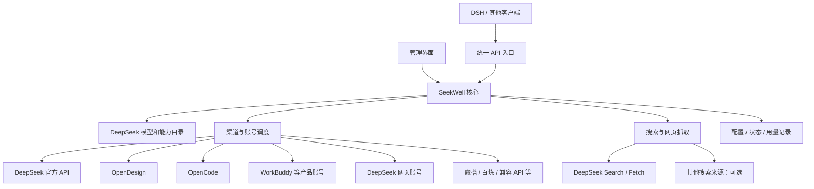

# SeekWell整体设计

- 状态：方案初稿，供讨论与设计确认；不表示实现已经完成。
- 日期：2026-11-12
- 范围：DeepSeek 模型及搜索、网页抓取能力的聚合与调度。

## 1. 目标

SeekWell 为使用 DeepSeek 的人提供一个统一入口：用户加入自己有权使用的官方 API、第三方 API、套餐、产品账号或现有代理，选择需要的 DeepSeek 模型，由系统根据具体能力、账号状态与用户策略选择可用来源；搜索和网页抓取也可统一管理。

目标覆盖所有可接入的 DeepSeek 来源，并持续扩充渠道目录。发现一个渠道、获得其使用资格、将其接入以及验证其可用是不同的事情；系统不承诺自动拥有所有来源的额度，也不能因为产品界面上出现了 DeepSeek 就认定它可用于外部 API。

典型场景：用户拥有 WorkBuddy、OpenDesign 和 DeepSeek 官方 API。客户端选择 DeepSeek Flash，SeekWell 选择满足模型版本、上下文、工具调用等条件的候选渠道。首选来源在输出前限流时，尝试其他合格来源；官方付费 API 是否参与自动兜底由用户明确设置。模型可以使用第三方来源，搜索则可以独立使用 DeepSeek 官方 Search / Fetch。

### 产品原则

- 只聚合 DeepSeek 家族模型及相关搜索、抓取能力；未来型号通过目录扩展，不固定为两个型号。
- 对外模型和能力易于理解，对内保留渠道、账号、真实模型版本及每次调用来源。
- 相同名称不等于相同能力或版本；证据不足的渠道标记待确认，不静默当作精确等价。
- 免费、套餐和按量付费来源可以共存，付费兜底由用户明确选择。
- 可用性、价格、额度和平台政策可能变化；记录验证依据及时间，不把目录当成实时保障。
- 用户拒绝使用 Magpie；本方案不以其为运行依赖或实现基础。

## 2. 系统边界与整体结构

推荐第一版采用独立服务加管理界面，支持本地运行；服务器部署也纳入目标，但涉及登录态、可达性和持久化差异，需要分别验证。不预设 DSH 必须常驻。对于需要 DSH 才能工作的适配器，可以作为单独的可选上游连接，不能把它包装成无此依赖的原生能力。

## 3. 关键对象

| 对象 | 含义 | 关键数据 |
| --- | --- | --- |
| 统一模型 | 用户选择的 DeepSeek 型号或精确版本 | 稳定标识、显示名、版本要求、能力要求 |
| 渠道模型 | 某渠道实际提供的模型 | 上游 ID、声明版本、上下文、输出上限、工具和图片等能力、证据来源 |
| 渠道 | DeepSeek 官方、OpenDesign、WorkBuddy 等 | 连接方式、适配器、可查询的能力及限制 |
| 账号或凭据 | 该渠道中的一个可用身份或 Key | 状态、额度、重置时间、上次核验时间、凭据引用 |
| 搜索来源 | DeepSeek Search 或其他搜索服务 | 搜索 / 抓取接口、认证、费用及能力 |
| 请求记录 | 一次用户请求及其候选尝试 | 模型、实际渠道和账号标识、切换原因、耗时、用量和费用信息 |

记录要区分上游明确返回、适配器声明、实测以及推断；未知就是未知。模型标识和能力以渠道实时目录、官方文档和验证为依据，旧别名可能指向新版本。官方提供 [模型列表接口](https://api-docs.deepseek.com/api/list-models/)。

## 4. 请求链路与调度

1. 客户端请求统一模型，提交消息、工具、图片或其他所需能力。
2. 入口解析协议和请求，确定模型版本、能力、上下文及费用要求。
3. 目录筛选确实满足请求的渠道模型；不确定的能力按已知信息如实处理，不假装支持。
4. 为候选选择可用账号，依据用户设置和已知额度信息排序。
5. 适配器转换并发送请求；记录实际渠道、尝试结果和上游返回的用量。
6. 结果按客户端所用协议返回，流式响应逐步透传。

推荐初始策略：用户设定的渠道顺序优先；同等条件下优先使用快过期的已知额度；会话尽量保持渠道亲和以减少缓存损失；失效账号和限流账号暂时避开；付费渠道只按用户明确设置参与。可提供手动顺序、额度优先、轮换和指定渠道等策略，具体默认行为在实现前确认。

余额未知不等于余额充足，也不等于不可用。显示为未知，并允许按用户策略尝试。不同渠道的请求限流、账号额度和模型限流需要分别记录，不能因一个模型耗尽而推断整个账号失效。

### 失败与恢复

- 在任何内容发送给客户端之前，认证失败、额度不足、限流、超时等可按照错误类型和策略尝试下一个合格候选。重试次数与时间有界，保留每次尝试原因。
- 内容已输出后，不拼接其他渠道的新回答；明确结束或报告中断，由客户端或用户发起新请求。
- 若请求引用渠道专有会话、文件或其他不能跨渠道使用的状态，只有确认能恢复所需上下文时才切换；否则明确失败，不虚报成功。
- 保持会话亲和可提高缓存命中，但不是保证。切换来源可能改变延迟、缓存命中、费用和输出；要能看到实际来源。
- 保存的账号状态和冷却到期后重新评估；重启后恢复配置和必要状态，不能让过期状态永久阻断渠道。

## 5. 模型、搜索和协议

### 模型能力

目录应分别描述文本、思考、流式、工具调用、图片 / 文件、上下文和输出限制。模型版本和能力可能随渠道变化；每项尽量保存其证据、检查时间和实测状态。对确切版本不明的模型，不自动并入要求精确版本的池。

### 搜索和抓取

[DeepSeek Search / Fetch](https://api-docs.deepseek.com/guides/search/) 是独立的搜索与网页抓取 API；某些渠道的模型内置联网搜索则是另一种能力。第一版优先验证官方 Search 和 Fetch，并清楚显示搜索来源与费用。其他来源可扩展，但不把第三方搜索标成 DeepSeek 官方搜索。

模型来源与搜索来源可以不同。各客户端是否会调用SeekWell暴露的搜索接口，需要按其真实入口分别验证；仅实现聊天接口并不自动接通搜索。官方搜索已按其现行价格规则收费，具体金额以官方文档和账号为准。

### 对外接口

设计目标包括 OpenAI Chat Completions、OpenAI Responses、Anthropic Messages，以及明确的搜索 / 抓取入口。具体实现顺序以第一批实际客户端为准。各协议共用模型目录与调度，但转换不能被当成能力完全相同的证明；必须验证工具调用、流式、思考内容、图片 / 文件、多轮上下文与错误处理。

## 6. 渠道与项目复用

本节是公开文档盘点，不代表已对代码、许可证、真实账号或实际模型调用完成审计。使用前核对上游最新版本、许可证、依赖与渠道使用条件。

| 来源 / 项目 | 候选能力 | 初步接入方式与边界 |
| --- | --- | --- |
| [DeepSeek 官方 API](https://api-docs.deepseek.com/) | 模型、协议、Search / Fetch | 按官方接口原生接入，作为能力基准之一。 |
| [OpenDesign](https://open-design.ai/model-credits/)；[llm-proxy](https://github.com/denysvitali/llm-proxy) | 套餐与模型 API | 先核对套餐、API Key、模型目录和版本；文档中有 OpenDesign 接入线索，尚未实测。 |
| [dsh-providers-hub](https://github.com/iJetLi/dsh-providers-hub) | WorkBuddy、CodeBuddy、CodeArts、Qoder 等账号及聚合 | 研究登录、账号和模型适配；也可评估其本机网关。它依赖 DSH，独立复用性及许可证待核实。 |
| [wb-proxy](https://github.com/cty1735/wb-proxy) | WorkBuddy、Qoder、TRAE 多账号与网关 | 仓库标注 MIT；优先评估作为外部服务连接，再审查可抽取代码及其来源。 |
| [opencode2api](https://github.com/jasonxu114514/opencode2api) | OpenCode Zen / Go、Key 池、兼容 API | 可评估外部服务接入；仓库标注 GPL-3.0-or-later，代码复用前核对许可与分发方式。 |
| [dsh-deepseek-web](https://github.com/irerc/dsh-deepseek-web)；[FreeDeepseekAPI](https://github.com/dekrezz/FreeDeepseekAPI) | DeepSeek 网页账号及会话代理 | 可先连接现有网关。网页接口非官方公开 API，稳定性、账号限制和实际功能需验证。 |
| [ai-proxy](https://github.com/HitMargin/ai-proxy) | 多渠道协议适配经验 | 可参考设计；仓库标注 GPL-3.0，直接复用代码前核对许可。 |
| [ModelScope](https://www.modelscope.cn/models/deepseek-ai/DeepSeek-V4.1-Flash-1017)、[阿里云百炼](https://help.aliyun.com/zh/model-studio/deepseek-v4-1-flash)、[腾讯云 TokenHub](https://cloud.tencent.com/document/product/1823/132358)、[NVIDIA NIM](https://docs.api.nvidia.com/nim/reference/nvidia-deepseek-v4_1-flash)、[OpenRouter](https://openrouter.ai/deepseek/deepseek-v4.1-flash/providers) | 各自提供的 DeepSeek 模型 | 通过各自官方 API 和用户凭据接入；型号、地域、额度、能力和价格以渠道当前规则为准。OpenRouter 本身是聚合渠道，其下游不应重复算成用户持有的独立额度。 |
| 自行部署 | 开放权重的 DeepSeek 模型 | 通过自有兼容 API 接入；算力、模型版本和运维由部署方负责。 |

优先采用标准 API 原生适配、复杂产品账号先连接现有服务的组合；确认长期价值、代码依赖和许可后，再决定抽取还是重新实现。第三方客户端的登录态和协议可能改变，各渠道需要单独维护与验收。

## 7. 计划中的接入次序

这是建议顺序，不代表这些渠道已经实现或可用。可依据用户已有账号调整。

1. DeepSeek 官方 API 和 Search / Fetch：建立基准及搜索链路。
2. OpenDesign：验证套餐型 API 与模型目录。
3. WorkBuddy / CodeBuddy：验证产品登录、账号池与真实调用。
4. OpenCode：验证 Zen / Go 模型、额度和调用方式。
5. ModelScope、百炼等标准兼容 API：验证通用 API 适配。
6. DeepSeek 网页账号：评估非公开接口和会话的长期维护成本。
7. Qoder、TRAE、CodeArts、Cline 等：先验证具体账号当前是否提供目标 DeepSeek，再接入。

## 8. 运行与数据管理

- 第一版建议单进程模块化服务、管理界面和 SQLite；不按假设规模提前拆分微服务。服务和现有渠道代理可独立运行。
- 保存渠道配置、凭据引用、模型目录、账号状态、用户策略和调用元数据。凭据由用户控制；界面和日志不展示完整密钥。删除渠道或账号时应明确处理相应配置和凭据。
- 日志默认记录完成调度和故障排查所需的元数据，是否记录请求正文应由用户选择；用量和价格未知时显示未知或估算，不写成确定费用。
- 面向本地与服务器部署分别核对登录态存放、进程重启、网络可达性、访问控制及备份 / 恢复。服务器登录、多人共享和多机部署不默认等同于本地单用户能力。
- 查看渠道状态时显示来源、验证时间、故障原因和额度是否可查询。健康检测不能仅凭进程存活就宣称真实模型调用成功。

## 9. 关键决策与待验证事项

| 决策 | 建议及取舍 | 状态 |
| --- | --- | --- |
| 独立服务 | DSH 和其他客户端可共用；比插件更独立，但要负责协议兼容。 | 建议，待确认 |
| 单体 + SQLite | 减少部署负担，适合初期；不假设满足未来多机高并发。 | 建议，待确认 |
| 外部代理 + 原生适配 | 尽早复用现有能力，但部分渠道可能需要额外进程。 | 建议，待技术验证 |
| 模型与搜索分离 | 可组合来源，需分别处理客户端接口。 | 建议，待确认 |
| 明确付费兜底 | 保护用户对费用的预期；具体默认方式需确认。 | 待确认 |
| 编程语言与代码许可证 | 先核实复用边界和现有项目依赖，再选语言和许可证。 | 未决定 |
| 模型等价与版本证据 | 精确版本证据不足时不得假称等价；具体宽松匹配选项待设计。 | 原则已提出，细节待确认 |
| 用户端与部署范围 | 当前以单用户自托管为初始假设；多人共享和托管服务不在已确认范围。 | 假设，待确认 |

需重点验证：WorkBuddy 等适配能否脱离原宿主使用；OpenDesign 实际套餐 API 是否满足需求；DSH 的模型和搜索如何完整接入；跨渠道工具、文件、缓存、思考和流式转换是否保持语义；当前上游免费活动、许可及账号规则。

## 10. 第一版验收建议

1. 添加官方 API、OpenDesign、WorkBuddy 中实际可用的账号，在界面查看渠道状态、模型和额度是否可查询。
2. 通过统一 DeepSeek Flash 入口，用至少两个确认版本及能力兼容的渠道完成真实对话。
3. 完成一次真实工具调用及工具结果回传，并检查多轮上下文。
4. 用 DeepSeek 官方 Search 找网页、用 Fetch 抓取，确认来源和实际费用信息。
5. 让首选渠道在输出前限流或失败，确认切到合格候选并展示实际来源；输出后中断不拼接新回答。
6. 验证付费兜底开关；余额未知、额度耗尽、凭据失效时如实显示并遵守配置。
7. 验证长会话、上下文边界、需要图片或文件的代表性请求，以及不具备跨渠道恢复条件时的明确失败。
8. 重启服务后恢复配置、凭据引用与必要状态；登录失效有明确提示。
9. 在选定的真实客户端（包括 DSH）验证实际模型和搜索入口。模拟测试用于覆盖错误和边界，不代替真实渠道验收。

## 11. 下一步

先确认整体方向和需要作业务决定的部分，再按第一批渠道核对项目代码、许可证、账号和实际接口，形成可实施的详细方案及验证计划。当前文档不构成实现、生产部署或其他后续阶段的授权。
